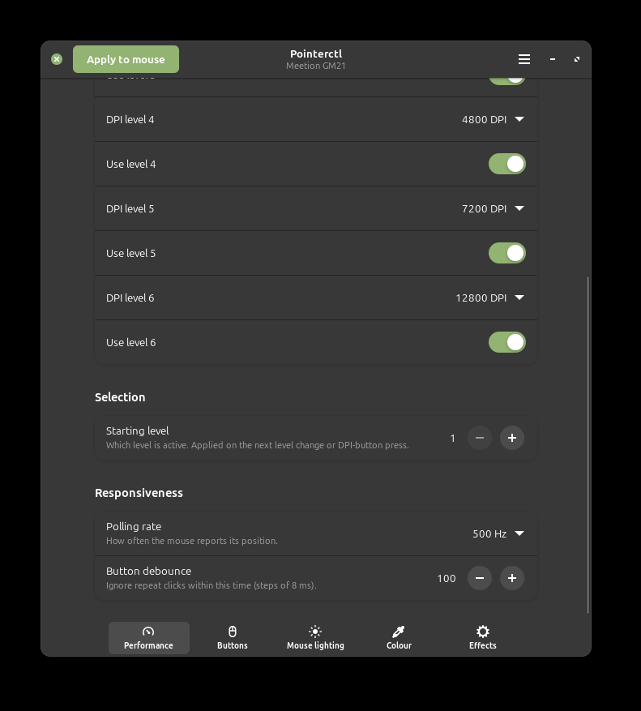
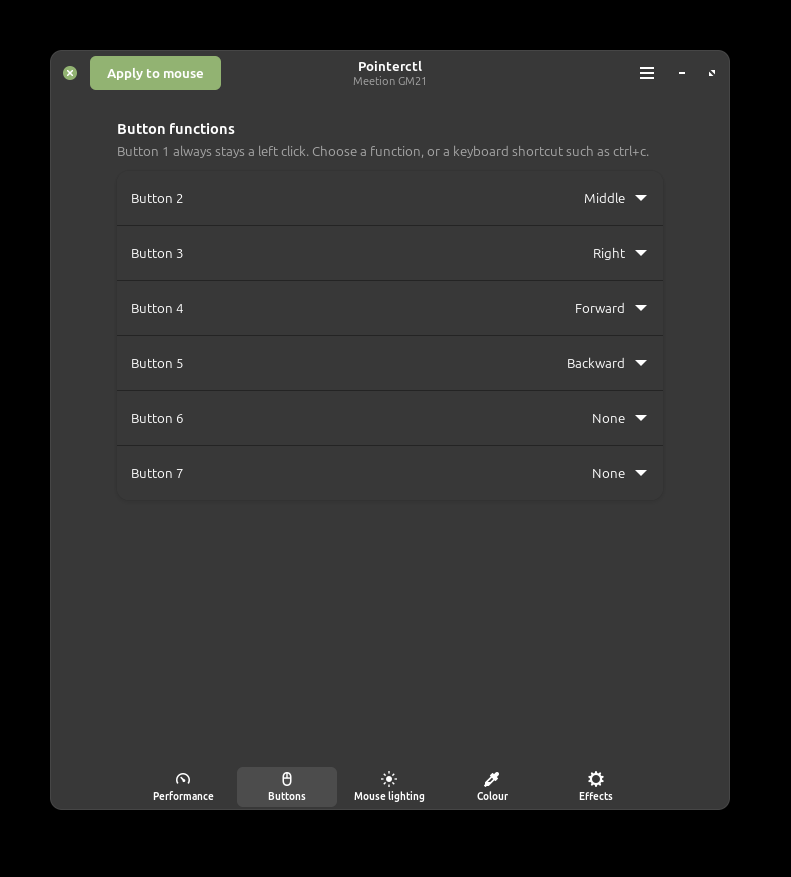
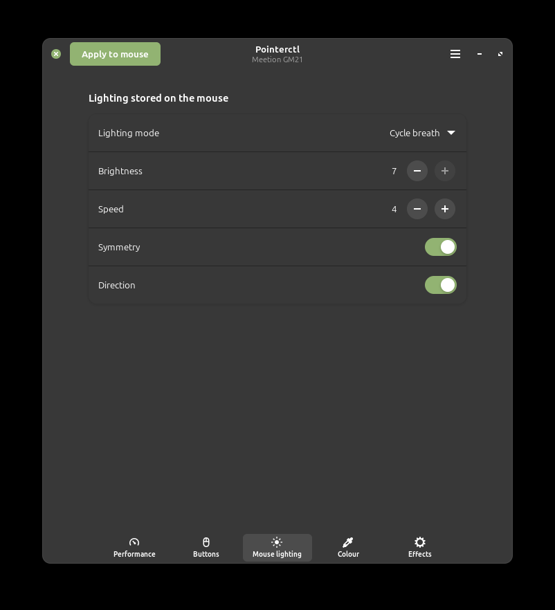
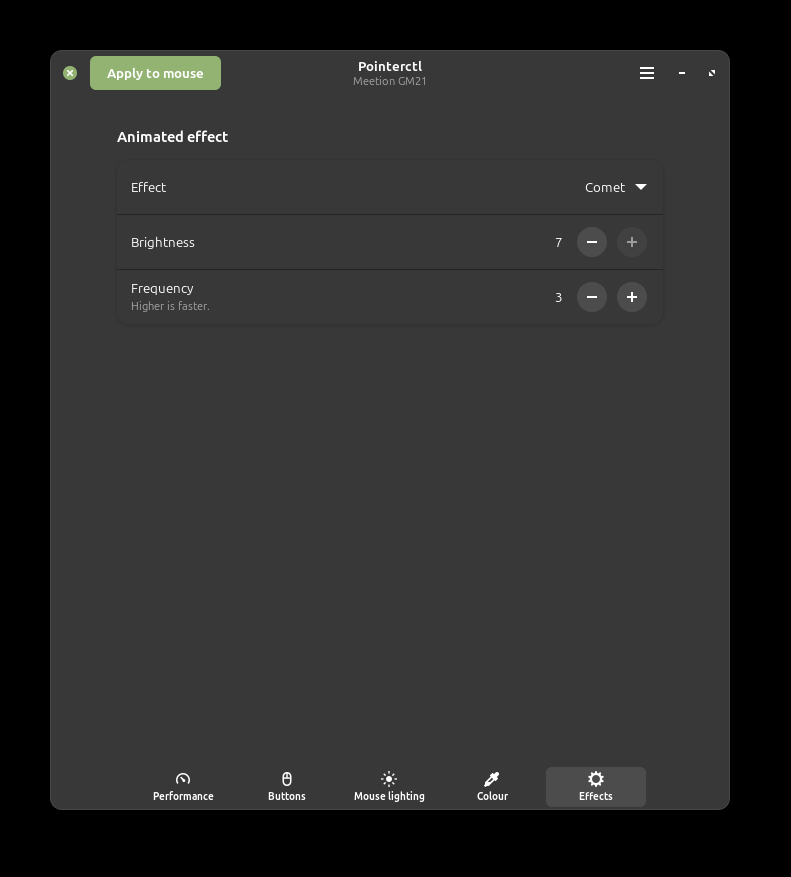

# pointerctl

Unofficial, open-source configuration tool for mice on Linux, starting with the Meetion GM21. It lets you change the settings stored on the
mouse (DPI levels, polling rate, button debounce time, buttons and lighting) without the manufacturer's Windows software.
It talks to the mouse directly over `hidraw`. There is no kernel driver, no Windows emulation and no root needed after the
one-time udev setup.

> **Not affiliated with, or endorsed by, any mouse manufacturer.** Product names such as "Meetion GM21" are used only to say which
> hardware this works with.
> The code is original. The device protocol was worked out mainly by observing the USB traffic of the author's own mouse, for
> interoperability. No manufacturer software, images, text or configuration files are included.

## Status

| Mouse | Status |
|---|---|
| **Meetion GM21** (`30fa:1441`) | works, tested on one unit |
| GM19, GM20, GM23, GM31 | **untested**, same USB id as the GM21, probably similar but not identical. The tool refuses them unless you set `POINTERCTL_FORCE=1`. |
| Keyboards, mouse pads and other device families | not supported (different protocol) |

Want your mouse supported? It's designed for that: see [docs/adding-a-mouse.md](docs/adding-a-mouse.md).

## Help wanted: test and add mice

This project only grows with people who own the hardware. Every kind of help is welcome, including partial support
(even just the polling rate of a new mouse is a good start).

**1. Test what exists.**
- **Own a Meetion GM21?** Try the window or the command line and tell us what worked and what didn't:
  [open a test report](https://github.com/naOomeow/pointerctl/issues/new?template=test-report.yml).
- **Own another model** (GM19, GM20, GM23, GM31 or a different mouse)? Start with read-only commands that send nothing:
  `python3 -m pointerctl identify` and `python3 -m pointerctl list`, then
  [ask for support](https://github.com/naOomeow/pointerctl/issues/new?template=new-device.yml) and paste the output.
  Please do **not** add `--yes` (the part that writes to the mouse) on a model that isn't marked tested unless you accept the risk:
  the tool only writes configuration, never firmware, but another model may lay its settings out differently. We'll tell you the
  safest first thing to try.

**2. Add your own mouse.** You don't need to be a programmer. You need the mouse, some patience, and a way to run the
manufacturer's configuration software once (Windows, or a Windows VM). The short version: identify the mouse, capture the USB traffic
while changing one setting at a time, compare the captures to see which byte changed, then describe that byte in a small
JSON profile. The full guide is [docs/adding-a-mouse.md](docs/adding-a-mouse.md). You can do it two ways:

- **By hand**, following the guide and the helper in `tools/`.
- **With an AI assistant such as [Claude Code](https://claude.com/claude-code)**: clone this repository, start the assistant in the
  folder (it reads [CLAUDE.md](CLAUDE.md) automatically, which holds this project's rules) and tell it what you want. It can read your
  captures, work out the encoding, draft the profile and the tests, and run them. You still plug in the mouse, run the manufacturer's
  software and approve every write to the device. There is a ready-to-use prompt in the guide.

**3. Share it.** Open a pull request with the profile and its test fixtures, or just an issue with your findings if you'd rather
not. Tell us what you verified on real hardware and what you couldn't test. Please keep raw captures and the manufacturer's files to
yourself (see [CONTRIBUTING.md](CONTRIBUTING.md)).

## Screenshots

| Performance | Buttons |
|---|---|
|  |  |
| **Mouse lighting** | **Effects** |
|  |  |

## What works (GM21)

- Six DPI levels (any value the mouse supports, 200 to 12800), which level is selected, which levels are active
- Polling rate: 125 / 250 / 500 / 1000 Hz
- Button debounce time
- Buttons 2-7: keyboard shortcuts (`<modifier>+<key>`), mouse functions (left/middle/right, back/forward, double click, fire, show desktop, DPI+/DPI-, none) and media keys
  (play/pause, volume up, mute, next track, stop, calculator). Button 1 stays a left click.
- The mouse's own LED mode (14 modes), brightness, speed, symmetry, direction
- Colour and effects: a solid colour (7 colours) and animated effects, with brightness and frequency. These are stored on the mouse
  (a solid colour was confirmed to survive unplugging it)
- Diagnostics: polling rate measurement, raw button events, movement counts

Not yet: recorded macros and multi-modifier shortcuts, colour choice inside the animated effects, reading settings back from the mouse.

## Install

**Debian, Ubuntu, Linux Mint** (a `.deb` is built with `./packaging/build-deb.sh`; it also installs the udev rule):

```bash
sudo apt install ./dist/pointerctl_0.1.0_all.deb
# unplug and replug the mouse once, then open "Pointerctl" from the menu, or run: pointerctl-gui
```

**Other distributions / from source** (Python 3.9 or newer; the window needs PyGObject, GTK 4 and libadwaita):

```bash
git clone https://github.com/naOomeow/pointerctl && cd pointerctl
./udev/install.sh            # one-time: lets your user access the mouse (asks for sudo)
# unplug and replug the mouse once
python3 -m pointerctl list      # should show your mouse as "supported"
python3 -m pointerctl.gui       # the window
```

`pipx install .` gives you the `pointerctl` and `pointerctl-gui` commands. Flatpak, RPM and Arch recipes are in
[packaging/](packaging/README.md).

## Use

The window (`pointerctl-gui`) has a page for performance (DPI levels, polling rate, debounce), buttons, the lighting stored on
the mouse, and colour/effects. Change things, then press **Apply to mouse**. The mouse cannot be read back, so the window
remembers what you last applied. The command line does the same:

Commands build the frames first and **send nothing** unless you add `--yes`.

```bash
python3 -m pointerctl params config                              # list parameters
python3 -m pointerctl config dpi1=800 dpi2=1600 rate=1000        # dry run
python3 -m pointerctl config dpi1=800 dpi2=1600 rate=1000 --yes  # send to the mouse
python3 -m pointerctl config led_mode=ripple led_brightness=5 --yes
python3 -m pointerctl config enable2=0 enable6=0 --yes           # skip levels 2 and 6 on the DPI button
python3 -m pointerctl config button7=calculator button2=play-pause --yes   # remap buttons
python3 -m pointerctl config button4=shortcut:ctrl+c --yes       # a keyboard shortcut on a button (one modifier + one key)
python3 -m pointerctl solid color=red brightness=5 --yes         # solid colour (stays on the mouse)
python3 -m pointerctl effect mode=neon brightness=3 frequency=6 --yes
python3 -m pointerctl diag measure                               # polling-rate check; move the mouse
```

Notes:

- `config` writes the **whole** configuration, so parameters you don't give go back to their defaults
  (1200/2000/3200/4800/7200/12800 DPI, 500 Hz, 100 ms, ambient). Give every setting you care about in one command.
- A new DPI value for the *selected* level takes effect when the level changes (press the DPI button once).
- The mouse never reports which DPI level it is on.

## Safety

- It only writes the mouse's configuration, the same kind of data the manufacturer's software writes. It never touches firmware.
- **Writes are permanent.** Everything it sends, including a colour or effect, is stored in the mouse's non-volatile memory (a colour
  survived unplugging). Memory like this wears out after enough writes, and the limit is unknown. Use Apply when you want to change
  something, not in a loop, a timer or a script that fires many times a day. Animations or audio-reactive lighting driven from the
  computer are therefore not supported and not recommended.
- Every frame is a template recorded from a real mouse with a few well-understood bytes substituted; values are checked
  against the ranges the mouse supports. Nothing is sent without `--yes`.
- It refuses devices that don't match a profile. Other models share the GM21's USB id, so `POINTERCTL_FORCE=1`
  is needed to try them, and that is at your own risk.

## Tests

```bash
python3 -m unittest discover -s tests -v
```

The tests rebuild 51 sequences captured from a real GM21 and require byte-for-byte equality.

## How it works

A mouse is described by a **profile** in `pointerctl/profiles/<id>/`: how to recognise the device, tables, the
parameters of each action, and small patch expressions that say which byte of a captured frame template
changes for which setting. The engine is the same for every mouse. See [docs/protocol-gm21.md](docs/protocol-gm21.md)
and [docs/profile-format.md](docs/profile-format.md).

## Contributing

Please do! See "Help wanted" above. New mice, test reports, bug reports with `pointerctl identify` output, and more decoded settings are all welcome.
Read [CONTRIBUTING.md](CONTRIBUTING.md) first, especially the rules about what must not be committed.

## License

MIT, see [LICENSE](LICENSE).
